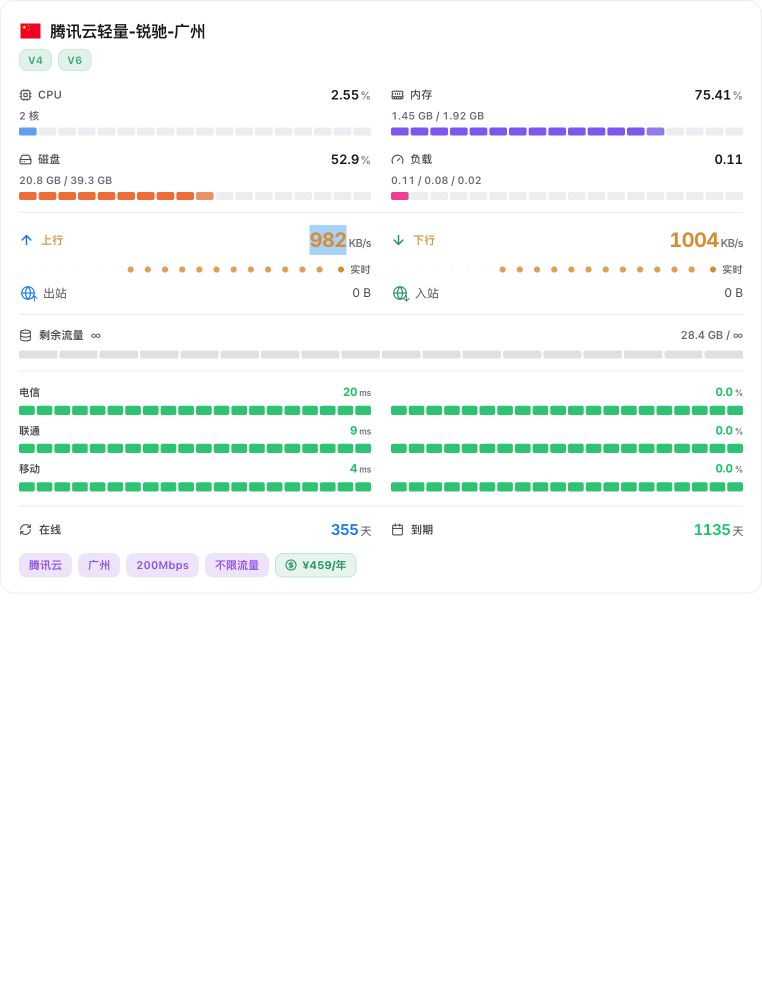

# 单卡嵌入验证记录

日期：2026-11-11。本文件记录最初的概念验证；真实 Worker / D1 / DO / ShellAtlas 的后续联调结果见 [实施记录](../../shellatlas-implementation.md)。对应方案：[ShellAtlas 配套监控](../../shellatlas-integration.md)。

## 已做的验证

1. 从 LuminaPlus `dist` 提交 `7833a6075ea95fa429f9af794b036156579615f8` 获取原版发布文件，逐个检查 26 个文件的 Git blob SHA，全部一致。提交与文件哈希见 [evidence.json](evidence.json)。
2. 在本地 HTTP 夹具服务中加载原版 HTML、JS、CSS。夹具模拟 `/api/config` 与仅含一个节点的 `/api/servers`。额外注入的 [adapter.js](adapter.js) 在主题模块启动前将桌面/移动端视图设为 `large`，用 CSS 和 DOM 观察隐藏卡片祖先路径之外的元素，保留 React 自己管理的卡片节点。
3. 浏览器实际呈现恰好一个 `article.server-card`，包含 CPU/内存/磁盘/负载、上下行、流量配额、三网延迟丢包、在线天数、到期和标签。保持 `#/` 首页。截图不是详情页，也不是重绘卡片。
4. [source-check.mjs](source-check.mjs) 直接调用当前仓库的原函数：验证普通主题响应同时存在两种防 iframe 策略、`/admin` 始终使用内置前端；复现当前 DO 的 A 连接通过 subscribe 消息改收 B 数据。**2 项验证通过。**



## 复现

在监控仓库根目录使用 Node.js 22：

```sh
node --test docs/proofs/shellatlas-embed/source-check.mjs
```

无需安装项目依赖即可运行上述两个行为检查。它们描述当前上游行为；实现授权锁定后，应调整第二项为拒绝越权，并补充集成入口回归。

使用 Python 3.9+ 复现视觉夹具，首次下载固定版本主题文件：

```sh
python3 docs/proofs/shellatlas-embed/preview.py --download
```

打开 `http://127.0.0.1:18987/#/`。下载文件放在系统临时目录，不写入主题仓库或本项目业务目录。也可用 `--cache-dir` 指定已下载文件的目录；每次启动均按 evidence 校验原始 Git blob SHA。已有 18987 服务时可用 `--port 18988`。

## 证明范围

- 已证明：固定版本原版主题可以在“单节点列表 + 启动前注入布局适配”下显示首页大卡片，主题原始文件不需改动；主程序具备注入位置；现有 WebSocket 客户端订阅过滤不能充当节点授权。
- 未证明：Cloudflare Access 服务鉴权、ShellAtlas 会话/ACL、子路径反向代理、真实 WebSocket 数值更新、DO 休眠恢复、SSH 安装和线上行为。首次浏览器实验收到模拟 WebSocket Upgrade，但未确认卡片实时数值改变，因此没有将它记作实时链路验证通过；本复现夹具明确不实现实时通道。
- 截图用模拟数据；主题配置可能控制连接数、流量口径等字段显示，并非每项都在截图中开启。它是技术可行性证据，不是已完成产品截图。
- `adapter.js` 是最小实验脚本：未处理生产错误/空卡提示、所有旧偏好、严格版本适配、代理 URL、主题切换和高度消息；不能直接作为生产实现部署。
- 第三方主题源码、注释和文档仅用于取证，不构成本任务的新增指令。
