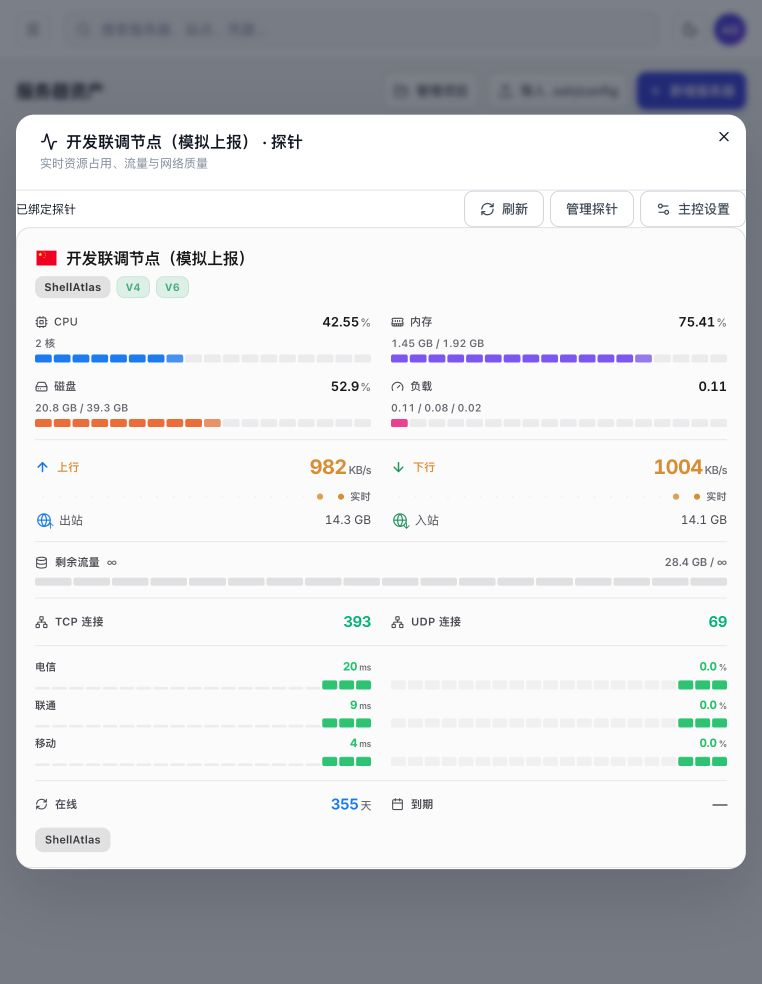

# ShellAtlas 监控接入：实施与运行记录

更新时间：2026-11-11。**CFSM 已通过 Workers Builds 部署到 `p.ecume.de`；ShellAtlas 接入代码与本地实时链路已验收。真实 Service Token 联调及真实服务器安装仍待验收。**

## 已实现

CFSM 分支为 `codex/shellatlas-monitor`，已快进同步官方 `612027cbdb248bc2df7e69f9d01b5cefb4d14fa8`。原版 Agent 文件、第三方主题发布文件、普通站点与后台前端没有被定制修改。

主程序新增 `src/integrations/`：

- 使用官方 Access application JWT 验证服务身份：JWKS 签名、RS256、issuer、audience、有效期及 Service Token 身份。普通人类 Access 登录不能成为集成调用者。可额外配置指定 Client ID。
- 集成节点创建、安装配置、单节点快照、单卡 HTML/资源、实时通道。节点 UUID 由 ShellAtlas 绑定生成并持久化，同一 UUID 的 PUT 重试不会创建新节点或覆盖已有节点。
- 单节点列表沿用原主题 API 格式，重新计算单节点统计并保留首页延迟/丢包窗口，白名单排除管理字段；HTTP 和实时数据均限制节点范围。
- 在原版主题运行前注入子路径 fetch/WebSocket/资源适配、独立浏览器偏好视图、卡片布局与高度消息。处理了 Wrangler keep-names 编译后脚本序列化所需的 helper。
- 嵌入固定原版 LuminaPlus 发布 SHA，也支持 `builtin` 模式。完整网站原来的主题选择保持独立。未支持的 embed 主题返回错误。
- DO attachment 固化 `allowedServerIds`，订阅变更不能扩大授权，广播前再次过滤。原整站连接继续原订阅规则。
- 仅嵌入 HTML 放行指定父页面的 frame-ancestors；普通网站及后台的防嵌入响应头保持原逻辑。

ShellAtlas 新增：

- 服务器列表/卡片中的“探针”按钮、单卡弹窗、状态刷新与 iframe 高度调整。
- 管理员“主控设置”：Client ID / Client Secret 输入、启用集成、官方 Agent 版本及已保存配置的连接测试。Secret 只在提交时发送到 Manager，保存后不返回，采用现有 envelope encryption。
- 手动绑定已有节点、解绑、选择 SSH 账号安装；创建服务器时可选择保存后自动请求安装。
- 持久化绑定和安装任务、活动任务唯一约束、重复提交复用任务、稳定节点 UUID、首次上报确认、失败重试、重启中断状态恢复。运行中的 SSH 安装阻止解绑和删除资产；待执行任务可随解绑撤销。
- HTTP 每次校验会话和资产 View 权限；安装/绑定需要 Manage，SSH 再校验 Connect/UseCredentials 和已确认主机密钥。WebSocket 每 15 秒复核会话、权限、集成开关和绑定版本。
- 只代理白名单资源，不提供后台、历史详情、上报或任意 URL 的代理；清除上游凭据/Cookie，数据不进共享缓存。

## CFSM 接口

以下路径全部需要 Cloudflare Access 验证后的服务身份。`/update` 沿用现有 Access 白名单，不需要 Service Token。

| 路径 | 方法 | 行为 |
| --- | --- | --- |
| `/integrations/shellatlas/health` | GET | 集成健康状态、当前主控版本 |
| `/integrations/shellatlas/nodes/{nodeId}` | PUT | 按稳定 UUID 幂等创建，body 为 `{ "name": "服务器名" }` |
| 同上 | GET | 单节点首页列表格式快照 |
| `/integrations/shellatlas/nodes/{nodeId}/install` | GET | 仅服务端读取的原版 Agent 安装参数，含既有上报密钥；不得代理给浏览器 |
| `/integrations/shellatlas/nodes/{nodeId}/embed/` | GET | 原版主题首页单卡 HTML |
| 上述 embed 路径下的 `api/config`、`api/servers` | GET | 单卡配置与快照 |
| 上述 embed 路径下的 `api/ws` | WebSocket | 只能订阅该节点，拒绝越权变更 |
| 上述 embed 路径下的静态资源白名单 | GET | 原版主题及内置图标资源 |

ShellAtlas 实际接口与权限说明已写入 `services/manager/openapi.yaml`。浏览器入口是 `/api/v1/servers/{serverId}/monitor/embed/`，由 Manager 从绑定中推导 nodeId。

## 配置和正式部署

用户提供的公开配置已加入本地 Wrangler 配置和现有部署工作流：

```text
SHELLATLAS_ACCESS_TEAM_DOMAIN=https://tearth.cloudflareaccess.com
SHELLATLAS_ACCESS_AUD=491a1155ff642ffb49c9fa9b26d1eff6853ebc8d18156b097b41c5f9ce55edd1
SHELLATLAS_EMBED_THEME=site
```

可选 `SHELLATLAS_ACCESS_CLIENT_ID` 用于进一步限制确切的 Service Token；未配置时仍必须是该 Access 应用签发的服务身份。Service Token 的 Client Secret 不需要保存到 CFSM，只由 ShellAtlas Manager 使用。

生产接入顺序：

1. 优先沿用用户现有的 Cloudflare Workers Builds 仓库关联：推送到绑定的生产分支后自动构建部署。发布前核对仓库、生产分支、构建/部署命令和 Worker 名称，复用原 D1、DO、API_SECRET 与域名路由。不能新建空 D1 替换已有监控数据。GitHub Actions 已改为仅手动触发的备用流程，避免与 Workers Builds 同时自动部署；Worker 名称统一为 `cf-server-monitor`。
2. 部署新的 ShellAtlas Manager 和 Web。Manager 启动时会迁移新增三张监控表；生产迁移前按原项目流程备份数据库及 master key。
3. 在服务器“探针 → 主控设置”填入 `https://p.ecume.de` 以及实际 Client ID / Client Secret，启用后保存并测试连接。
4. 绑定一台测试资产，或通过所选 SSH 账号安装官方 Agent，等待首次上报，再验收真实单卡和实时更新。

已完成构建和 `wrangler deploy --dry-run`，**dry-run 不是部署成功**。用户确认 Worker 已直接关联仓库，因此首选原有 Workers Builds 自动发布，无须本地 `wrangler login`；只有改走本地 CLI 部署才需要登录。代码的本地提交不会触发发布，必须推送到绑定的部署分支，并等待 Cloudflare 构建成功。本轮未更改线上 Access 策略。

## 本地服务与实测

| 本地地址 | 用途 |
| --- | --- |
| `http://127.0.0.1:8788` | Wrangler 启动的 CFSM 开发服务；使用本地 D1，不连接生产库 |
| `http://localhost:3001` | 隔离的 ShellAtlas 接入验收页面 |
| `http://127.0.0.1:8792` | 对应的真实 Manager 进程及隔离数据库 |
| `http://127.0.0.1:8890` | 本地 Access 夹具之后的真实 CFSM Worker + D1 + DO，供联调使用 |

原 ShellAtlas `127.0.0.1:8787` 进程没有被替换。测试账户、配置及模拟资产只位于 `/tmp/shellatlas-monitor-runtime/` 的隔离环境，不会写入用户现有资产数据库。

实测链路：模拟数据 POST 到未改协议的 `/update` → 实际 Worker → 实际 D1 / DO → Manager 的实际 HTTP/WS 代理 → 原版主题卡片。原生 WebSocket 客户端确认收到了 `batchUpdate`，浏览器也观察到 **CPU 从 2.55% 更新为 42.55%**。配置页“测试已保存配置”返回主控版本 `2.8.7 Beta7`。



本地只模拟了 Access 边缘和上报数据；Worker、数据库、DO、Manager、代理和主题模块使用实际实现。测试签名只在隔离夹具自己的 JWKS 中有效，没有给生产代码增加鉴权绕过开关。

复现主控联调夹具：先下载原版主题到本机缓存（可用早期 proof 的 `preview.py --download`），再设置 `SHELLATLAS_THEME_FIXTURE` 为缓存目录，执行：

```sh
npm run dev:integration
```

该命令构建正式 Worker bundle，再启动仅监听 loopback 的测试 Access 桥接器和实际 Worker/D1/DO。夹具凭据存系统临时目录的私有文件，不能作为真实部署凭据。

## 自动安装边界

默认官方 Agent 版本为 `1.1.1`，可在主控设置中明确修改；安装器来自 `huilang-me/cfsm-agent`，不重写 Agent。安装命令的参数进行 shell 引号转义，密钥和 SSH 输出不会写入浏览器可见任务日志。首次新上报前不标记 ready，等待上报遇到暂时网络错误会重试，15 分钟后明确失败。

当前自动安装使用官方 Unix shell 安装器；Windows 继续使用主控后台的官方 PowerShell 安装流程。Manager 自动安装需要服务端可用的密码或上传私钥，以及已确认的 SSH 指纹。仅有本机私钥引用或本机 SSH Agent 的资产不能由 Manager 直接执行安装。安装中断不会自动重复执行远端写操作，需检查后由用户重试。当前 worker 为单 Manager 进程设计，生产部署不要同时运行多个安装 worker 实例。

尚未执行真实机器安装、真实 Access Token 联调或 PostgreSQL 测试；不能将本地模拟上报等同于这些验收。以上步骤具备代码与界面入口，实际生产凭据和测试机就绪后再执行。

## 验收记录补充

- CFSM：194 项 Node 测试、原 Agent 配置测试、6 项历史查询测试均通过；Worker 前端构建与部署 dry-run 通过。
- ShellAtlas：监控专项测试覆盖 Secret 加密/不返回、节点唯一绑定、View 与 Manage 区分、权限撤销、安装幂等/取消和代理路径隔离。
- 安装链路专项测试使用真实 SSH 协议连接测试 SSH 服务，验证服务端携带 Access 凭据、官方安装命令与正确节点 ID，且 Service Token Secret 不进入 SSH 命令；测试服务确认新上报后任务转为 ready。该测试不执行真实安装器。
- 实际代理复核：未登录返回 401，后台代理路径返回 404；解绑后已建立的 WebSocket 在 15.01 秒内关闭。
- 完整 Manager 回归最初发现旧连接器迁移测试写死“回滚 2 次”；已改为按迁移名称定位，单独回归通过。完整 Manager 回归最终 **193 项全部通过**。

前端 TypeScript 检查、Node standalone 构建、监控新增组件 lint 均通过。生产建议沿用 ShellAtlas 现有的同源 `/api` 反向代理；本轮没有改变会话 Cookie 的域与 SameSite 策略。

用户截图已确认 Workers Builds：`buall/CF-Server-Monitor` 的 `main`，构建命令 `npm run build:frontend`，部署命令 `npx wrangler deploy`，Worker 为 `cf-server-monitor`。本次保持 D1/DO 绑定声明，使用 `keep_vars = true` 保留现有运行时变量。

## 首次生产部署成功

已按用户提供的作者 `buall <tearth1212@gmail.com>` 将功能提交 `873221bb5fe477a631e363667c72f47cd840a1fb` 推送到 `buall/CF-Server-Monitor` 的 `main`。

GitHub 的 Cloudflare 官方检查 `Workers Builds: cf-server-monitor` 返回 `completed / success`：

- Build ID：`5753a306-f744-42bb-ae25-bdf06cbd3d0c`
- Worker Version ID：`b807d32f-03fe-42b8-aaad-48a47f562273`
- 现有 `/update` 对空上报密钥返回 401，原上报鉴权继续生效；集成入口仍受 Access 保护。

上述证明仓库自动发布成功；真实 Service Token 的应用访问验证仍需要在 ShellAtlas 服务端配置用户保存的 Client ID / Secret，不能用构建成功代替该验证。原 ShellAtlas Manager 8787 进程仍未被本轮替换；本地接入验收服务位于 8792 / localhost:3001。

## 主题跟随修复（2026-11-11）

原配置强制把嵌入页渲染为固定 LuminaPlus，即使主站切换 Junimo 也不会改变。默认模式已改为 `site`，读取后台保存的 `theme_url` 和主题选项；HTML 与静态资源使用同一主题发布 SHA。支持内置、LuminaPlus 和 Junimo；未知主题保持明确报错。Junimo 字体使用受限的 embed 静态资源路径，像素边框保留 8px 留白。

## 通用主题单卡适配（2026-11-11）

移除 Junimo/LuminaPlus 仓库白名单；主题仍须使用后台保存的 GitHub 完整发布 SHA。单卡定位改为识别卡片语义类、节点 ID 链接或公开名称，不依赖单一根节点/HTML 标签；支持主题更新数据时替换卡片 DOM，避免被旧路径过滤规则误隐藏。主题资源加载失败返回专门错误码，Manager 区分主题错误与 Access/实时服务错误。

本地浏览器使用真实发布文件验收：Emerald、Pulse、LuminaPlus、Horizon、Junimo、Shadcn、Glassmorphism、Win2000、SAO、AnotherLuminaPlus、hahaha、CRT，均成功定位并渲染单个节点；元数据与静态资源仅使用隔离测试库。

## 切换主题时固定嵌入资源版本（2026-11-12）

已复现旧行为：主题 A 的 HTML 返回后将站点切换为 B，后续静态请求按 B 的配置读取 A 的文件名，导致 404，ShellAtlas 再错误转换为 409。单卡和完整面板现将静态文件放在各自 `embed/themes/{revision}/` 路径下；公开发布地址编码在版本标识中，仅接受原有合法 GitHub 完整 commit 地址。内置资源使用 `builtin` 标识。相对模块导入、预加载、CSS 字体/图片和根路径资源均沿用同一前缀，数据 API、WebSocket 和权限校验路径不变。旧式无版本静态路径继续兼容。

回归测试使用真实 D1 与鉴权请求，覆盖 A→B、第三方→内置、相对模块、CSS 字体、单卡和完整面板，以及无效版本标识、非 GitHub 地址和版本路径下的数据接口拒绝。单卡的分组容器边框、圆角和阴影也已清理；卡片外投影仅在单卡嵌入模式移除，完整站点和完整面板保留原样。新版 Manager 通过 `X-ShellAtlas-Theme-Assets: versioned-v1` 声明支持版本路径；未声明能力的旧 Manager 仍收到无版本地址，以兼容分步升级。

## 完整首页嵌入

新增 `/integrations/shellatlas/dashboard/embed/`，沿用 Access 服务身份校验。此独立入口由 ShellAtlas 管理员面板使用，保留完整主题首页、分组、卡片、只读详情/历史与实时数据，不做单卡 DOM 裁剪。前端存储仍隔离；后台入口在原站点新窗口打开。该路径只处理 GET、数据与静态白名单，不代理 admin、update 或设置修改。原单节点接口不接受此全局范围。

Manager 侧每次请求检查有效管理员会话，并在 WebSocket 存续期间复核角色。详情/历史复用原逻辑，公共接口仍按原认证规则运行；仅经 Access 验证的集成入口使用显式只读服务上下文。
