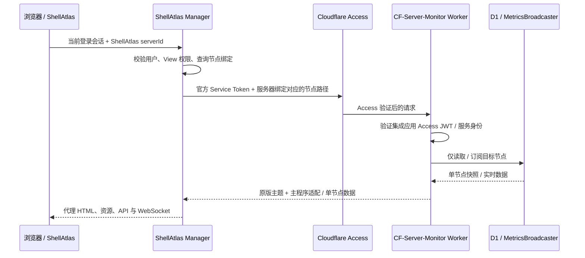

# ShellAtlas 配套监控：源码结论与实施方案

核对日期：2026-11-11。状态：**已进入实施，CFSM 与 ShellAtlas 的接入代码已完成并通过本地实时链路验收；线上部署及真实机器安装待验收。**

当前代码、接口、部署步骤和测试结果见 [实施与运行记录](shellatlas-implementation.md)。下文保留最初的源码分析与设计依据，拟定接口以实施记录为准。

## 1. 决策与范围

主控继续运行在 Cloudflare Workers + D1 + Durable Objects。完整监控站、管理后台、主题商店、主题切换、历史与实时监控保留。新增的嵌入入口呈现**指定服务器的首页大卡片**，不进入 `/#/server/:id` 详情页。

第三方主题和 Agent 保持官方原版。主程序负责嵌入入口、按节点限制数据、WebSocket 权限约束、HTML 注入与主题兼容适配；ShellAtlas 负责资产与监控节点绑定、SSH 自动安装、权限检查、服务端代理和探针按钮。

按用户补充确认：

- `/update` 已在 Cloudflare Access 中加入白名单，现有 Agent 可以正常上报。这是现有部署条件，**不再规划新的上报网关或下发 Access 凭据**。
- ShellAtlas → 监控主控的服务间鉴权直接使用 **Cloudflare 官方 Service Token**。不自建服务间签名令牌、嵌入 JWT 或票据体系。
- Service Token 仅在 ShellAtlas 服务端使用。最终用户会话、资产权限仍由 ShellAtlas 验证；Service Token 不表达某个用户的服务器权限。

最初分析阶段只新增了文档及隔离验证材料；后续业务实现与验证结果见实施记录。Agent 和第三方主题保持原版。

## 2. 源码基线与 Git 状态

| 对象 | 已核对的版本 |
| --- | --- |
| 当前监控工作区 | `609cc0b0998793510453be8eadced2064b28ad7d`，提交说明为 2.8.7 Beta6；`package.json` 的版本号尚为 2.8.6，不以它单独判定基线 |
| 当前 `origin` | `https://github.com/buall/CF-Server-Monitor.git`，已存在；本轮未创建新的远程 Fork |
| 官方 `upstream/main` | `612027cbdb248bc2df7e69f9d01b5cefb4d14fa8`，2.8.7 Beta7；本轮已添加 `upstream` 并 fetch |
| 与官方差距 | 当前 HEAD 落后上述 `upstream/main` 10 个提交，领先 0 个；本轮未合并更新 |
| ShellAtlas | `/Users/tearth/Downloads/shell-atlas`，HEAD 为 `1f16c69e75c22ca7d97b6089022be3cfc9ed4b36`；存在其他任务的未提交修改，分析以实际工作区为准 |
| LuminaPlus 源码 | `volcano-1025/CFSM-Theme-LuminaPlus`，`main`：`abf1571361a24b2f9b49bba61df86158703fc877` |
| LuminaPlus 发布文件 | 同仓库 `dist`：`7833a6075ea95fa429f9af794b036156579615f8`，HTML 标记 `LuminaPlus v1.2.23` |

主题源码分支与发布分支分别固定了 SHA；没有将“源码可重复构建得到该发布文件”当作已验证事实。已将发布分支 26 个文件的原始 Git blob SHA 与实际下载字节逐一比对，全部一致，见 [evidence.json](proofs/shellatlas-embed/evidence.json)。未将主题发布文件复制进本仓库。

## 3. 已验证结论

| 结论 | 源码证据与含义 |
| --- | --- |
| 后台可以独立保留 | `src/handlers/frontend.js` 的 `shouldUseBuiltinFrontend()` 固定让 `/admin`、`/admin/*` 使用内置前端；第三方主题不接管后台。已用原函数验证 |
| 存在集中适配入口 | 同文件的 `loadThemeIndex()`、`normalizeThemeAssetUrls()`、`injectAppearanceSettings()`、`buildHtmlResponse()` 已经代理主题 HTML/资源、注入配置和外观。可以在独立 embed 分支注入适配器，无须改主题仓库 |
| 当前页面不能直接 iframe | `buildHtmlResponse()` 设置 `X-Frame-Options: DENY`；`src/utils/csp.js` 设置 `frame-ancestors 'none'`。两项都已用原函数验证。仅改一项不够 |
| 首页与详情页是不同组件 | 内置路由 `src/frontend/router/index.js` 的 `/` 是 `Dashboard.vue`，`/server/:id` 是 `ServerDetail.vue`。前者使用首页卡片；不能把详情页裁剪后称为首页单卡 |
| 内置主题与附图并非同款卡片 | `ServerBarCard.vue`、`ServerRingCard.vue` 是内置卡片。LuminaPlus 的 `src/components/node/NodeCard.tsx` 提供附图所需的资源指标、流量点阵、三网、在线时长、到期和标签结构，可复用它的首页大卡片 |
| LuminaPlus 支持在启动前选择大卡 | `src/hooks/useViewMode.ts` 读取桌面、移动端各自的 sessionStorage override，值为 `large`；`NodeGrid.tsx` 按该值渲染 `NodeCard`。已实际加载原版发布文件验证 |
| 单卡需要列表格式的数据 | 内置首页读取 `/api/servers`；LuminaPlus 的 `src/services/api.ts:getServersSnapshot()` 同样读取它。返回兼容结构且 `servers` 只有目标节点即可复用首页渲染 |
| `/api/server` 不是列表接口的完整替代 | `src/handlers/dashboard.js` 中列表接口还返回 `stats`、`regionStats`、`sysConfig`、`latestReportUpdates`，并附加首页 `ping`、`loss` 窗口。详情接口没有完成同样的首页窗口组装 |
| 首页小柱图仍需保留 | 列表按 `show_three_net_details` 读取最近 2 小时、最多 20 个点的首页延迟/丢包窗口。这不同于打开历史曲线详情页；嵌入要保留该数据才能复现三网展示 |
| 当前没有用户级节点 ACL | `src/middleware/auth.js` 主要判断站点管理员 JWT；`is_hidden` 只控制公开可见性，不是 ShellAtlas 用户权限。不能把 Service Token 当成原有管理员 JWT 使用 |
| WebSocket 支持节点过滤，但过滤不是授权 | `MetricsBroadcaster._shouldDeliver()` 已按 scope/ids 过滤；`webSocketMessage()` 允许客户端重新提交 scope/ids，覆盖 attachment。已复现从 A 改订阅 B 并收到 B 数据；需要增加不可扩大的授权集合 |
| 只设置 API Base 不能解决子路径代理 | 内置 `utils/config.js:computeWsBase()`、LuminaPlus `services/cfsm/config.ts:toWebSocketBase()` 都只保留协议与 host，丢弃 pathname。必须另行适配 WebSocket 路径 |
| Agent 安装应使用官方 Go Agent | `src/frontend/views/admin/index.vue:getCustomInstallCommand()` 默认下载 `huilang-me/cfsm-agent` 的安装器，带 `-id`、`-secret`、`-url=<origin>/update`、可选 `-ua`、`--install-version`。不能把本仓库旧版 `public/install.sh` 当成当前默认安装流程 |

**可行性结论：** 对已核对的 LuminaPlus，采用“主程序注入启动参数和布局适配 + 服务端只返回单节点列表 + 服务端锁定实时范围”的方案，可以在不修改主题发布文件的前提下实现首页单卡嵌入。已实际验证其中的原版主题单卡渲染；鉴权、代理、权限锁定和真实实时链路仍待实现与联调。

**兼容性边界：** 嵌入默认跟随 CFSM 后台保存的主题（`SHELLATLAS_EMBED_THEME=site`），当前支持内置主题、LuminaPlus 和 Junimo。第三方主题沿用后台保存的发布 SHA，不再强制替换为固定 LuminaPlus；不支持的主题明确返回兼容性错误。可显式设为 `builtin` 或 `luminaplus` 使用独立固定主题。单卡样式适配只作用于嵌入页，Junimo 像素边框保留留白，CSS 内的根路径字体/图标地址映射至受限代理路径。

## 4. 推荐链路：官方 Service Token + ShellAtlas 权限代理



### 4.1 两层权限各自负责什么

1. **服务身份：** Manager 请求主控时添加 `CF-Access-Client-Id` 和 `CF-Access-Client-Secret`。直接复用现有 Access 应用，添加 `Service Auth` 策略并仅允许指定 Service Token；原有网站的人类用户策略与 `/update` 白名单继续使用，无须额外创建应用。
2. **用户资产权限：** Manager 复用 `authenticate_request()` 产生的 `SessionPrincipal`，根据 URL 中的 ShellAtlas `serverId` 读取资产，执行与现有资产查询一致的 `SiteCapability::View`。再从数据库解析监控 `nodeId`，不能接受浏览器提供的 `nodeId` 覆盖绑定。
3. **主控集成入口：** 不因为请求带了某个自定义头就信任调用者。校验 Access 下发的 `Cf-Access-Jwt-Assertion` 的签名、issuer、audience、有效期；使用用户提供的现有应用 AUD，并验证 Service Token 的 `common_name` 与空 `sub`，与普通人类登录区分；可再用 `SHELLATLAS_ACCESS_CLIENT_ID` 限定确切令牌。采用 Cloudflare 官方验签方式/JWKS，不自定义令牌协议。
4. **节点范围：** Worker 从经过验证的集成路由得到节点范围，所有查询和 WebSocket attachment 均受它约束。Manager 每个请求都重新验证用户与绑定；WebSocket 建连后定期复核会话、View 权限和绑定版本，撤销后关闭两端连接。不能只在生成 iframe 时检查一次。

Access 不会替代原有 `/admin/api` 的应用内 JWT 校验。应新增限定能力的集成入口，不能把 Service Token 直接塞入 `Authorization: Bearer`，也不能为了嵌入把它等同于管理员登录。

### 4.2 浏览器入口与路径契约（拟定，尚未实现）

建议浏览器访问：

```text
/api/v1/servers/{shellatlasServerId}/monitor/embed/#/
```

Manager 将该前缀下的白名单请求代理到：

```text
/integrations/shellatlas/nodes/{cfNodeId}/embed/
```

| 浏览器代理前缀后的路径 | Worker 集成前缀后的路径 | 规则 |
| --- | --- | --- |
| 空路径 | 空路径 | 返回首页 HTML，注入 embed 上下文和主程序维护的适配脚本 |
| `api/config` | `api/config` | 仅返回单卡展示所需配置 |
| `api/servers` | `api/servers` | 返回兼容原主题的单节点列表 |
| `api/ws` | `api/ws` | 双向 WebSocket 转发，授权范围固定为该节点 |
| `assets/*`、`static/*`、`flags/*`、`os-icons/*` | 对应路径 | 仅允许主题及内置静态资源；禁止路径穿越和任意上游 URL |

主程序 embed bootstrap 在主题脚本前运行，将主题对根路径 API 和 WebSocket 的请求转换到当前代理前缀。HTML 资源地址也由主程序改写，主题 bundle 的相对 import 继续相对本地代理资源目录解析。必须测试动态 import、预加载、CSS 字体与图片；不能仅靠 `<base>` 或 `apiBase` meta 完成。

主程序只在 embed 页面注入这些兼容逻辑；ShellAtlas 负责受限代理，无须维护各主题的 DOM 选择器。代理前缀必须由部署配置和服务器 ID 构造并严格校验，不能从任意客户端 URL 反射进 HTML。

默认不代理 `/admin`、`/admin/api`、`/api/theme_options`、`/api/history/all`、`/update`、数据库维护、整站 `/api/servers` 或任意上游 URL。有主题初始化额外调用时，先查源码确认用途，再增加受节点限制的最小只读兼容接口。

Manager 丢弃客户端伪造的 Access/集成头，重新构造上游鉴权头；不向浏览器转发这些头、上游管理员 Cookie、Access Cookie 或管理员 JWT。Service Token 不出现在 HTML、JS、URL、localStorage、日志和 SSH 安装命令中。

此子路径方案不需要额外登录票据。它会把主题脚本放在 ShellAtlas 的 origin，因而要求把所选主题作为受信任代码并固定经过验证的发布提交；它不是浏览器脚本隔离方案。如后续要求隔离主题脚本，应单独设计嵌入 origin 与会话传递，不能把同源 iframe 配上 `allow-same-origin` 就声称完成隔离。

### 4.3 页面和数据行为

- 页面保持首页 hash 路由 `#/`。用主题适配器强制桌面/移动端大卡、处理已有筛选与隐藏偏好、移除整站统计/导航/分组条/悬浮按钮/主题设置及详情跳转；保留卡片内部指标与三网小柱图。
- 使用 CSS 与观察 DOM 的适配脚本，保留主题框架管理的原节点，不抽取或搬动 React/Vue 节点，不依赖框架内部对象。
- 适配器按主题 ID 与发布提交维护选择器。目标卡片应恰好一张；加载失败、节点不存在或 DOM 不兼容时显示明确错误，不能显示整站作为兜底。
- 单节点列表保留 `servers`、`latestReportUpdates`、`stats`、`regionStats`、`sysConfig`。所有统计都根据目标节点重新计算；不得把全站统计、隐藏节点或其他节点 ID 带给浏览器。
- 单卡展示配置可以返回 `is_public: true`、`authorization: false`、关闭此嵌入上下文的 Turnstile UI，使主题以访客只读方式渲染。**这只是已鉴权集成响应的展示语义，不能改变全站设置、跳过 Manager ACL 或放开原 API。**
- 复用当前脱敏逻辑，额外通过字段白名单排除 `API_SECRET`、备注、管理设置、探测目标等不需要公开的内容。已有脱敏函数只是必要基础，不能直接把 `SELECT *` 的结果返回给浏览器。
- 复用首页延迟窗口和指标合并逻辑，查询限定为单节点；禁止为每张 iframe 执行整站 latest metrics 查询后再过滤。
- HTML/用户数据响应采用 `Cache-Control: private, no-store`；不进入共享 HTTP 缓存。内部指标缓存可以按节点复用，但返回前必须重新鉴权。主题静态文件按固定主题 SHA 和资源路径缓存，防止切换后串资源。
- 只为 embed HTML 设置精确的 `frame-ancestors` 允许 ShellAtlas origin；移除该响应的 `X-Frame-Options: DENY`，或同源部署改为 `SAMEORIGIN`。普通站点和后台继续原防嵌入策略。ShellAtlas 的 `frame-src` 及代理之后的最终响应头一起验收。
- 用 ResizeObserver 发送高度消息，父页面校验 `event.origin`、`event.source` 和当前 iframe/资产，更新高度；切换服务器、卸载或隐藏卡片时释放 WebSocket。

### 4.4 WebSocket 必须锁住授权范围

继续使用当前 DO 和 `batchUpdate` 协议，无须改 Agent 或主题消息格式。新增不可由客户端更改的 attachment 字段，例如 `allowedServerIds`（本场景恰好一个节点）。

建连时清除外部伪造的内部授权头，Worker 在 Access 集成验证后设置授权范围；scope、ids 与它取交集。后续每个 subscribe 消息也必须检查同一范围，拒绝越权改订阅；广播前再执行一次范围检查。更新订阅 attachment 时保留授权字段，兼容休眠恢复。原有完整站点连接按原规则运行。

不能仅将连接 URL 改成 `?subscribe=<nodeId>`：已验证客户端消息可以将它改回 `all` 或其他节点。Manager 也不能只在 HTTP Upgrade 前过滤 URL 而完全忽略连接期间的权限撤销。

## 5. 两边的代码改动边界

### 5.1 CF-Server-Monitor 主程序

| 区域 | 计划改动 |
| --- | --- |
| `src/index.js` | 增加隔离的集成路由分发；普通站点路由尽量不动 |
| 新增集成 Access 中间件 | 官方 JWT 验证、集成应用 AUD/服务身份校验、关闭时返回明确错误 |
| 新增集成 handler 与数据 helper | 单卡 HTML、兼容单节点列表/config、节点存在性检查、严格白名单与脱敏 |
| 新增主题适配器模块 | 主程序维护 builtin/LuminaPlus 的启动参数、CSS、DOM 兼容、代理 URL 路由与高度消息；不改主题仓库或 bundle |
| `src/handlers/frontend.js`、`src/utils/csp.js` | 抽出有限复用点；仅 embed 分支覆盖注入内容与防嵌入响应头 |
| `src/handlers/dashboard.js` | 抽取单节点快照与首页窗口组装 helper，保持旧接口行为；减少重复实现 |
| `src/durable/MetricsBroadcaster.js` | 在订阅接入、订阅变更、广播三个位置落实授权上限；尽量集中为小 helper |
| 新增节点 provisioning 接口 | 仅经官方 Service Token 允许的集成服务调用，创建/读取安装所需信息、校验首次上报；复用 `insertServerWithPartition()` 和缓存失效逻辑 |
| 测试/文档 | 嵌入隔离、权限、主题兼容及已有功能回归 |

**不归主控负责：** ShellAtlas 用户、资产/账号/SSH 密钥、资产与节点绑定、SSH 命令执行、安装任务状态、探针按钮。主控不复制 ShellAtlas 的用户与资产权限数据库。

节点创建应支持幂等请求键：同一 ShellAtlas 安装任务重复请求返回同一 CF 节点，解决“主控已创建、Manager 因超时未保存绑定”的问题。幂等记录只记录集成操作键与结果，不替代 ShellAtlas 的绑定表。不能直接重用原 `action:add` 后假设跨系统创建原子成功；它每次生成新 UUID。

### 5.2 ShellAtlas

| 现有位置 | 计划改动 |
| --- | --- |
| `services/manager/src/main.rs` | 注册监控配置/绑定/安装/状态/嵌入代理路由，沿用现有会话中间件 |
| 新增 `services/manager/src/monitor/` | 官方 Service Token 客户端、固定上游地址与路径白名单、HTTP/WS 代理、安装任务调度 |
| `db.rs` / `db/`、`entities.rs`、`migration.rs` | 监控实例配置、资产节点绑定、安装任务、审计；复用当前站点与用户组 ACL |
| `web_terminal.rs` / `ssh.rs` | 复用 `prepare_ssh_execution_as()` 与 `execute_command_with_output_limit()`、主机密钥确认、连接路径和凭据解密；安装属于专门的写操作，不借用只读巡检来执行 |
| `crates/domain`、`app/domain.ts`、`app/api.ts`、`services/manager/openapi.yaml` | 增加绑定、安装状态、监控状态契约；不给前端返回服务端密钥 |
| `app/features/servers/servers-page.tsx` | 在列表和卡片共用的 ServerActions 中加入“探针”按钮，打开单卡弹窗/抽屉 |
| `app/features/servers/server-dialogs.tsx`、`app/ssh-manager-app.tsx` | 添加机器流程启用监控选项、选安装账号与安装模式；机器创建成功后展示异步安装进度 |
| 新增监控展示组件 | iframe、加载/离线/未绑定/失败/无权限状态、调整高度与释放连接 |

ShellAtlas 当前的“测试连接”、巡检、AI 排障与监控探针是不同能力，应保留现有入口。当前工作区有其他未提交业务修改，实施时必须保留并基于实际差异增量开发。

## 6. ShellAtlas 数据、安装和生命周期

建议新增独立绑定表，不把所有第三方字段塞进 SSH Server 主模型：

```text
monitor_instances: id, name, base_url, enabled, encrypted_service_token, ...
server_monitor_bindings: server_id, instance_id, node_id, binding_version, ...
monitor_install_jobs: id, server_id, account_id, binding_version,
                      request_key, status, last_error, timestamps, ...
```

每个资产最多一个当前生效绑定；`(instance_id, node_id)` 唯一，防止两台资产误绑同一探针而泄露指标。Service Token 使用 Manager 现有服务端加密机制或部署 Secret 保存，不复用用户 SSH 凭据的前端展示接口。原版 Agent 所需 `API_SECRET` 与 Access Service Token 分开管理：前者属于既有上报协议并按原版安装流程写入目标机，后者绝不下发。

安装链路：

1. 创建 ShellAtlas 资产并保存监控安装意图，生成持久化幂等任务；资产创建不等待 SSH 安装完成。
2. 在执行前校验用户仍有效，并具有资产 Manage、SSH Connect 与 UseCredentials 等所需权限；不能仅因有 View 权限就安装。
3. 经 Service Token 调用主控 provisioning，创建或确认节点，原子保存本地绑定与任务阶段。绑定已有节点时校验实例、节点和绑定唯一性。
4. 按现有 SSH 能力检查主机密钥、路由、选定账号和可用权限。复用官方安装器参数，固定经过验收的官方 Agent 版本；自定义 UA 非默认时带 `-ua`。默认不另改 Agent。
5. 执行安装并脱敏记录结果。安装器退出码为 0 只代表安装命令结束，主控收到该节点首次新上报后才转为可用；超时显示“等待上报”或明确失败，不能伪装在线。
6. 任务状态至少区分 `pending / provisioning / installing / awaiting_report / ready / failed`。重试复用节点，不重复建号；Manager 重启后可恢复任务阶段并重查上报。

已知 SSH 限制：`ssh_execution_spec_as()` 的服务端执行当前需要密码或已上传私钥；本机密钥引用/SSH Agent 只能经 Launcher。不能承诺所有已有连接方式都能由 Manager 自动安装。第一期优先实现现有服务端可达的 Linux 路径；不支持的路由或凭据给出明确状态和官方手动安装路径，不能绕过主机指纹检查或静默复制凭据。

编辑地址、换 SSH 账号、改绑定或重装时增加 binding_version，旧任务不能覆盖新绑定。CF 后台直接删除节点后，ShellAtlas 应显示绑定失效；不通过自动发现无条件复活。删除 ShellAtlas 资产时终止任务/代理连接并解绑；删除主控节点及卸载 Agent 应作为明确的联动策略实现，避免后台隐式删除仍被其他用途使用的节点。

## 7. 分阶段实施与验收

### 阶段 0：本文与验证材料（本轮完成）

- 已添加 upstream、记录两个项目和主题版本、分析实际源码。
- 使用原函数完成两项源码行为验证，均通过；使用原版主题发布文件完成单卡浏览器渲染。
- 未执行真实用户/服务器鉴权、真实 Access、真实 DO 实时链路或 SSH 安装测试。

### 阶段 1：主程序单卡与权限约束

先在当前基线基础上评估/合并官方 10 个提交，独立于定制提交；新增集成入口、单节点数据、DO 授权上限和 LuminaPlus 适配器。验证桌面/窄屏、旧偏好、无数据/离线、只一张大卡、无法点击进入详情、首页三网窗口、主题升级不匹配时明确报错。补做内置主题适配后再列入支持矩阵。

### 阶段 2：ShellAtlas 代理与探针入口

完成会话/ACL + 官方 Service Token 代理。重点验证子路径下动态模块、API、WebSocket 的实际路由；一次打开两台不同资产不能串绑定或资源。通过真实 Access 环境验证所有请求/Upgrade，确认浏览器看不到 Token。

### 阶段 3：节点绑定与 SSH 安装

完成幂等 provisioning、安装队列、首次上报确认、失败重试、状态与审计；用真实测试机验收。现有 `/update` Access 白名单继续使用，确认 GET Upgrade 和 POST 两种现有上报方式符合实际启用模式。

### 必须通过的权限和回归检查

- 未登录、禁用用户、无 View 权限、过期会话：不能加载卡片或连接 WebSocket。
- 修改 ShellAtlas serverId、nodeId 查询参数、自定义头或绑定后缀；在 A 连接里订阅 B/`all`：不能获取 B 的快照、统计、ID、延迟窗口或实时帧。
- 长连接期间注销/撤销权限/改绑定：在规定复核周期内关闭连接；DO 休眠恢复后授权约束仍在。
- embed 不能调用后台、主题设置写入、历史详情或数据库维护接口。未知路径、方法、编码路径穿越不能落入普通前端兜底。
- 缓存不会在用户/节点间串数据；Service Token 缺失、过期、被撤销或上游重定向到登录页时显示明确错误，不把登录 HTML 当监控成功结果。
- 原版完整站点、后台登录、主题预览/切换、历史查询、实时连接与 Agent 上报保持可用；只为新增能力做局部回归，不修改主题与 Agent 验证这些需求。

## 8. 合并上游与验证材料

`origin` 保留个人 Fork，`upstream` 保留官方仓库。定制分支使用 `codex/` 前缀，按“主程序集成 / 主题适配 / ShellAtlas 接入”拆分提交，避免修改构建后的主题 JS 或复制整套 UI。新增配置缺失时关闭集成功能，原站点继续按原行为运行。

后续更新流程：`git fetch upstream` → 在更新分支合并官方 → 检查 frontend/dashboard/DO 这几个复用点 → 运行既有测试和集成测试 → 固定并验收新的主题发布 SHA → 部署。当前 CI 会重新生成 `wrangler.toml`，因此集成所需非敏感配置/绑定也要纳入部署工作流，不能仅改本地 TOML；密钥走部署 Secrets。

验证材料与复现命令见 [单卡验证记录](proofs/shellatlas-embed/README.md)。其中图片与数据均为本地夹具，只证明原版主题渲染可行，不代表线上监控或端到端鉴权已完成。

主要外部资料（均于核对日读取）：

- 官方主控：`https://github.com/huilang-me/CF-Server-Monitor`
- 主题发布规范：仓库 `theme-develop.md`；主题清单由 `src/utils/config.js:THEME_STORE_URL` 指定。
- LuminaPlus：`https://github.com/volcano-1025/CFSM-Theme-LuminaPlus`，上述固定源码/发布 SHA 下的 `src/hooks/useViewMode.ts`、`src/components/node/NodeGrid.tsx`、`src/components/node/NodeCard.tsx`、`src/services/api.ts`、`src/services/cfsm/config.ts`。
- Cloudflare Service Token：`https://developers.cloudflare.com/cloudflare-one/access-controls/service-credentials/service-tokens/`
- Cloudflare 官方 Access JWT 校验：`https://developers.cloudflare.com/cloudflare-one/access-controls/applications/http-apps/authorization-cookie/validating-json/`
